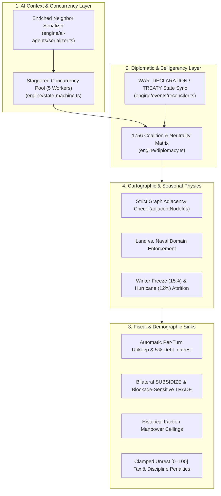

# Phase 6 Integration Plan: Historical Realism & Simulation Mechanics Overhaul

> [!IMPORTANT]
> **Objective:** Integrate all 7 mechanical and AI serialization recommendations identified during the 28-turn (`1756–1763`) autonomous campaign audit to eliminate friendly-fire coalition conquests, enforce land/sea movement domains and seasonal attrition, replace self-refunding subsidies with bilateral transfers, cap demographic hyperinflation, and prevent DeepSeek API burst throttling.

---

## Architectural Overview of Planned Upgrades



---

## Sequential Implementation Modules

### Module 1: Diplomatic Belligerency, Alliance & Neutrality Matrix (Finding 1)
- **Target Files:**
  - Create [`engine/diplomacy.ts`](file:///Users/sean/SevenYearsWar/engine/diplomacy.ts)
  - Update [`engine/state-machine.ts`](file:///Users/sean/SevenYearsWar/engine/state-machine.ts#L248-L350)
- **Specification:**
  1. Define diplomatic stances: `"AT_WAR" | "ALLIED" | "AUXILIARY" | "NEUTRAL"`.
  2. Seed initial 1756 alignments in `offMapModifiers.diplomaticMatrix` (and dynamically reconcile with active `WAR_DECLARATION` and `TREATY` rows in `GameEvent`):
     - `GREAT_BRITAIN` $\leftrightarrow$ `FRANCE`: `AT_WAR`
     - `GREAT_BRITAIN` $\leftrightarrow$ `GERMAN_STATES`, `PORTUGAL`: `ALLIED`
     - `FRANCE` $\leftrightarrow$ `SEVEN_NATIONS`, `WESTERN_CONFEDERACY`: `ALLIED`
     - `SPAIN`, `DUTCH_REPUBLIC`, `HAUDENOSAUNEE`, `SOUTHEASTERN_NATIONS`: `NEUTRAL` (until an active `WAR_DECLARATION` or cross-border `RAID` triggers `AT_WAR`).
  3. **Resolution Rule:**
     - `MOVE` into an `ALLIED` or `AUXILIARY` node reinforces the allied garrison without combat or ownership transfer (preventing `GERMAN_STATES` from capturing British `Boston` or `SEVEN_NATIONS` from capturing French `Quebec`).
     - `MOVE` into a `NEUTRAL` node is blocked unless preceded by a `WAR_DECLARATION` event; `RAID` against a `NEUTRAL` node inflicts frontier damage and automatically records a `WAR_DECLARATION` / `HOSTILITIES_OPENED` event.

---

### Module 2: Enriched Cartographic Neighbor Serialization (Finding 2)
- **Target Files:**
  - Update [`engine/ai-agents/serializer.ts`](file:///Users/sean/SevenYearsWar/engine/ai-agents/serializer.ts#L26-L86)
- **Specification:**
  1. Query all `MapNode` records for the game once inside [`getRoleContextPayload`](file:///Users/sean/SevenYearsWar/engine/ai-agents/serializer.ts#L26-L86) and build a lightweight `Map<nodeId, { id, name, nodeType, region, controllerType }>`.
  2. Replace raw CUID arrays in `controlledNodes` and `activeUnits` with resolved neighbor descriptors:
     ```ts
     adjacentNodes: n.adjacentNodeIds.slice(0, 5).map(adjId => ({
       id: adjId,
       name: nodeLookup.get(adjId)?.name,
       type: nodeLookup.get(adjId)?.nodeType,
       owner: nodeLookup.get(adjId)?.controllerType ?? "NEUTRAL",
     }))
     ```
  3. Verify via [`estimateTokenCount`](file:///Users/sean/SevenYearsWar/engine/ai-agents/serializer.ts#L88-L91) that total prompt size remains strictly $< 1,500$ tokens ($O(1)$ budget).

---

### Module 3: Bilateral `SUBSIDIZE` Transfers & Blockade-Sensitive `TRADE` (Finding 3)
- **Target Files:**
  - Update [`engine/state-machine.ts`](file:///Users/sean/SevenYearsWar/engine/state-machine.ts#L236-L247)
- **Specification:**
  1. **Decouple `SUBSIDIZE` from `TRADE`:**
     - **`SUBSIDIZE`**: Deducts `actualSpend` from the issuing faction. If `targetNodeId` is controlled by another faction (`targetNode.controllingId !== faction.id`), credits `actualSpend` directly to the recipient faction's `treasury` and increments the sender's `standingPoints` by `+1` (clamped to `10`). If `targetNodeId` is self-controlled, reduces the sender's `unrestIndex` by `Math.max(2, Math.floor(actualSpend / 10))`.
     - **`TRADE`**: Calculates commercial revenue as `Math.round(actualSpend * 1.25) + Math.round((sourceNode.resourceYield || 15) * 0.4)`. If an enemy `SHIP_OF_THE_LINE` occupies an adjacent `SEA_ZONE`, reduces trade revenue by `50%` (naval blockade interdiction).

---

### Module 4: Automatic Upkeep Sinks, Debt Interest & Historical Manpower Ceilings (Finding 4)
- **Target Files:**
  - Update [`engine/state-machine.ts`](file:///Users/sean/SevenYearsWar/engine/state-machine.ts#L48-L88) (`processDiplomaticTradePhase` and `processResolutionPhase`)
- **Specification:**
  1. **Per-Turn Upkeep & Debt Interest in `processDiplomaticTradePhase`:**
     - Deduct unit maintenance each turn:
       - `SHIP_OF_THE_LINE`: `0.025 £` per strength point
       - `REGULAR`: `0.015 £` per strength point
       - `MILITIA` / `MERCHANTMAN`: `0.008 £` per strength point
       - `NATIVE_WAR_PARTY`: `0.005 £` per strength point
     - Deduct `5%` interest on `faction.debt`. If `treasury` drops below `0`, convert the deficit into `debt` and increment `unrestIndex` by `+4`.
  2. **Historical Manpower Ceilings on `RECRUIT`:**
     - Define theater manpower ceilings per faction category:
       - European Powers: `12,000` total theater strength cap
       - Native Confederations: `5,000` total warrior strength cap
     - Scale recruitment rate (`base = actualSpend * 8`) by a diminishing-returns factor `Math.max(0, 1 - currentFactionStrength / manpowerCap)`.

---

### Module 5: Land/Sea Domain Enforcement, Graph Adjacency & Seasonal Attrition (Finding 5)
- **Target Files:**
  - Update [`engine/state-machine.ts`](file:///Users/sean/SevenYearsWar/engine/state-machine.ts#L248-L350)
  - Reuse [`computeEdgeConstraint`](file:///Users/sean/SevenYearsWar/components/map/map-geometry.ts#L117-L185) from [`components/map/map-geometry.ts`](file:///Users/sean/SevenYearsWar/components/map/map-geometry.ts)
- **Specification:**
  1. **Graph Adjacency Validation:** Reject `MOVE` and `RAID` orders where `targetNodeId` is not in `sourceNode.adjacentNodeIds`.
  2. **Domain Validation:**
     - `SHIP_OF_THE_LINE` and `MERCHANTMAN` can only move to `SEA_ZONE` nodes or coastal `TERRESTRIAL` ports (`Boston`, `Quebec`, `Fortress Louisbourg`, `Havana`, `New Orleans`, `Willemstad`, `Port Royal`, `Belém do Pará`).
     - Land units (`REGULAR`, `MILITIA`, `NATIVE_WAR_PARTY`) cannot end movement inside a `SEA_ZONE` node unless accompanied by naval transport.
  3. **Seasonal Movement Attrition:**
     - Evaluate `computeEdgeConstraint(sourceNode, targetNode, game.currentSeason)`:
       - If `edge.isFrozen` (`Winter` in `ST_LAWRENCE` / northern nodes): apply `15%` freeze attrition (`strength * 0.85`) to moving `REGULAR` and `SHIP_OF_THE_LINE` units (`NATIVE_WAR_PARTY` units with snowshoe mobility suffer only `5%`).
       - If `edge.hasHurricaneRisk` (`Autumn`/`Summer` in `CARIBBEAN` sea lanes): apply `12%` storm attrition (`strength * 0.88`) to moving naval units.

---

### Module 6: Clamped Unrest (`[0, 100]`), Standing (`[1, 10]`), and Unrest Penalties (Finding 6)
- **Target Files:**
  - Update [`engine/state-machine.ts`](file:///Users/sean/SevenYearsWar/engine/state-machine.ts) and [`engine/off-map-events.ts`](file:///Users/sean/SevenYearsWar/engine/off-map-events.ts)
- **Specification:**
  1. Clamp `unrestIndex` strictly to `[0, 100]` and `standingPoints` strictly to `[1, 10]` on all database mutations.
  2. Apply an **Unrest Fiscal Penalty** during `processDiplomaticTradePhase`:
     $$\text{Effective Node Yield} = \text{round}\left(\text{resourceYield} \times \left(1 - \frac{\text{unrestIndex}}{150}\right)\right)$$
  3. Apply an **Unrest Morale Penalty** during combat in `processResolutionPhase`:
     $$\text{Effective Discipline} = \text{discipline} \times \left(1 - \frac{\text{unrestIndex}}{200}\right)$$
  4. When `unrestIndex >= 80`, record a `COLONIAL_MUTINY` `UNREST` event via [`recordAndReconcileEvent`](file:///Users/sean/SevenYearsWar/engine/events/reconciler.ts#L4-L66) and apply a `10%` desertion loss to the faction's largest regular garrison.

---

### Module 7: Staggered Worker Pool for AI Concurrency (Finding 7)
- **Target Files:**
  - Update [`engine/state-machine.ts`](file:///Users/sean/SevenYearsWar/engine/state-machine.ts#L96-L165) (`processOrderSubmissionPhase`)
- **Specification:**
  1. Replace the single 30-request `Promise.all` burst with a bounded worker pool (`CONCURRENCY_LIMIT = 5`, `150ms` stagger between dispatches).
  2. Execute `EXECUTIVE` roles (`deepseek-v4-pro`) first so high-level strategic directives can be recorded before `MILITARY` and `DIPLOMATIC_COMMERCE` (`deepseek-flash`) sub-roles execute.

---

## Verification Test Suite (`tests/phase6-historical-realism.test.ts`)

| Test Case | Target Requirement | Expected Assertion |
| :--- | :--- | :--- |
| **1. Coalition Protection** | Module 1 (`engine/diplomacy.ts`) | `GERMAN_STATES` moving into British `Boston` reinforces the garrison instead of capturing the city from `GREAT_BRITAIN`. |
| **2. Enriched Neighbor Context** | Module 2 (`serializer.ts`) | `getRoleContextPayload` includes neighbor `name`, `nodeType`, and `owner` while keeping `estimatedPromptTokens < 1500`. |
| **3. Bilateral Subsidy Transfer** | Module 3 (`state-machine.ts`) | British `SUBSIDIZE` targeting Philadelphia deducts treasury from `GREAT_BRITAIN` and credits `GERMAN_STATES`. |
| **4. Upkeep, Manpower Cap & Unrest Clamp** | Modules 4 & 6 (`state-machine.ts`) | `unrestIndex` never exceeds `100`, `standingPoints` never exceeds `10`, and `RECRUIT` respects faction manpower ceilings. |
| **5. Adjacency, Domain & Winter Attrition** | Module 5 (`state-machine.ts`) | Non-adjacent `MOVE` is rejected; `Winter` movement across `ST_LAWRENCE` applies seasonal freeze attrition. |
