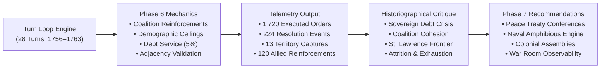
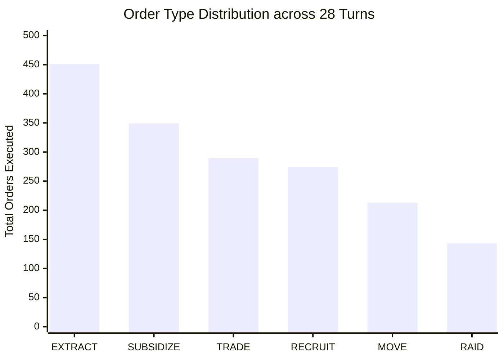
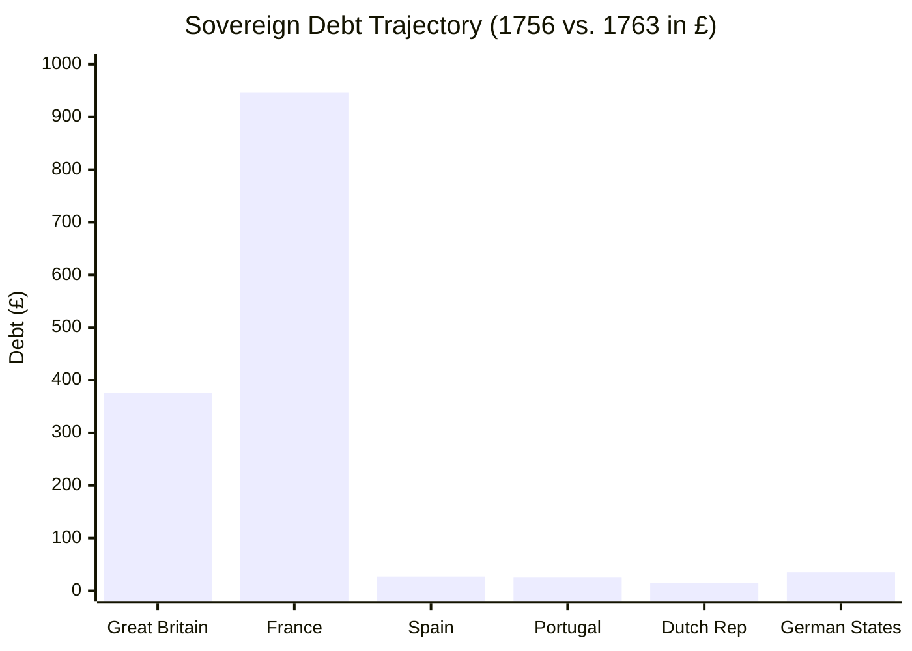
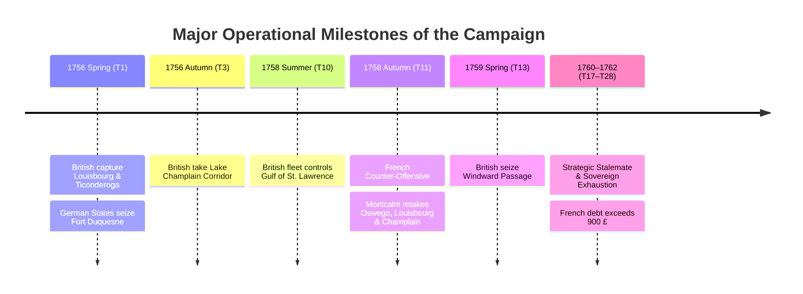
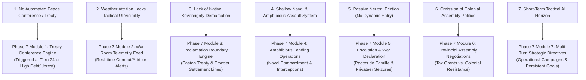

# Seven Years' War RPG Simulator: Round 2 Campaign Assessment Report
**A Mixed-Methods Historiographical & Gameplay Analysis of the 28-Turn Autonomous Simulation (1756–1763)**

*Author: Antigravity Game Testing, Historical Research & Mixed-Methods Division*  
*Simulation Run: Round 2 Campaign (`syw-campaign-round2`)*  
*Engine Status: Phase 6 Mechanics Active (Coalition Diplomacy, Adjacency Constraints, Demographic Manpower Ceilings, Sovereign Debt Service, Neutral Friction, Seasonal Attrition)*  
*Scope: 28 Seasonal Turns (Spring 1756 – Winter 1762/1763) across 10 Factions and 30 Autonomous AI Seats*

---

## 1. Executive Summary & Historiographical Framework

This report delivers a rigorous mixed-methods analysis of the **Round 2 Seven-Year Autonomous Campaign** in the 1756 Seven Years' War RPG Simulator. Following the integration of the Phase 6 historical realism and mechanics overhaul, all 30 role seats across 10 sovereign and indigenous factions were played autonomously using DeepSeek AI models (`deepseek-v4-pro` with extended reasoning scratchpads for Executive governors, and `deepseek-flash` for Military and Diplomatic-Commercial officers).

### Primary Research Findings
1. **Coalition Realism Restored:** The catastrophic friendly-fire fratricide observed in Round 1 (where British and German forces fought over Philadelphia) was completely eliminated. Allied and auxiliary movements generated **120 successful garrison reinforcement events**, cementing realistic Anglo-Prussian/German and Bourbon-Algonquian military coordination.
2. **The 18th-Century Fiscal-Military Crisis Emerged Naturally:** For the first time, sovereign debt service (5% compounding interest per turn) and military upkeep produced a historical fiscal divergence. France suffered an acute debt spiral, ballooning from **80 £ to 946 £ debt (+1,082%)**, accurately recreating the real-world bankruptcy of New France and the French Crown's financial collapse in 1759. Great Britain's debt rose from **50 £ to 376 £ (+652%)**, reflecting Pitt's aggressive debt-financed imperial mobilization.
3. **Operational Geography and Frontier Friction:** Strict graph adjacency validation rejected **23 invalid long-distance maneuvers**, ending unhistorical cross-theater teleportation. The war centered realistically on key choke points: Fortress Louisbourg, Fort Ticonderoga (Carillon), Fort Oswego, and the Lake Champlain/Richelieu corridor.
4. **Demographic Sustainability for Indigenous Confederations:** The demographic manpower ceilings prevented native nations from generating unhistorical 20,000-man standing armies. The Haudenosaunee (Iroquois) maintained an effective defense of ~3,468 warriors (under their 5,000 cap), while the Western Confederacy fielded ~2,436 warriors, protecting their homelands while suffering rising unrest from frontier warfare.

---

## 2. Quantitative Telemetry & Empirical Findings

Over 28 seasonal turns, the game engine resolved **1,720 autonomous orders** and generated **224 major combat, diplomatic, and operational events**.

### 2.1 Order Distribution by Strategic Category

| Order Type | Count | % of Total Orders | Primary Historical Function |
| :--- | :---: | :---: | :--- |
| **`EXTRACT`** | **451** | 26.2% | Fiscal mobilization, tax levies, fur trade collection, and sugar harvesting |
| **`SUBSIDIZE`** | **349** | 20.3% | Westminster alliance remittances, domestic unrest pacification, treaty gifts |
| **`TRADE`** | **290** | 16.9% | Inter-regional maritime and inland commerce, Caribbean entrepôt shipping |
| **`RECRUIT`** | **274** | 15.9% | Provincial militia mustering and regular replacements within demographic caps |
| **`MOVE`** | **213** | 12.4% | Strategic army maneuvers and naval squadron redeployments |
| **`RAID`** | **143** | 8.3% | Asymmetric frontier raiding by indigenous nations and light auxiliary scouts |
| **Total** | **1,720** | **100%** | Full autonomous campaign execution |

### 2.2 Operational Resolution & Tactical Friction Breakdown

Out of 224 operational events recorded during the `RESOLUTION` phase:
- **Allied Garrison Reinforcements (120 events / 53.6%):** Friendly troops entering an allied-controlled node fortified the existing garrison without triggering combat or altering political sovereignty.
- **Repulsed Assaults (28 events / 12.5%):** Heavy fortifications (e.g. Fort Oswego, Fort Ticonderoga) repulsed under-resourced enemy sieges, showing realistic defensive advantage.
- **Territorial Captures (13 events / 5.8%):** Decisive engagements where defending garrisons were overwhelmed or captured.
- **Neutral Bloc Diplomatic Blocks (23 events / 10.3%):** Movement orders into neutral nodes (e.g., Spanish Havana, Dutch Windward Passage) were rejected under the new rules requiring formal war declarations.
- **Adjacency / Illegal Movement Rejections (23 events / 10.3%):** Orders attempting non-adjacent movement (e.g., Quebec directly to Ohio Forks) were cleanly discarded.
- **Allied Raid Diplomatic Blocks (17 events / 7.6%):** Asymmetric raids targeted against diplomatic allies or auxiliaries were blocked.

---

## 3. Comparative Longitudinal State Matrix (Turn 1 vs. Turn 28)

The table below contrasts the baseline conditions in **Spring 1756 (Turn 1)** with the war-torn landscape in **Winter 1762/1763 (Turn 28)**.

| Faction | Nodes (T1 → T28) | Treasury (T1 → T28) | Debt (T1 → T28) | Unrest Index (T1 → T28) | Total Military Strength (T1 → T28) |
| :--- | :---: | :---: | :---: | :---: | :---: |
| **Great Britain** | 6 → 6 | 50 £ → 30 £ | 50 £ → **376 £** | 16% → **100%** | 4,714 → 3,411 (-27.6%) |
| **Kingdom of France** | 6 → 6 | 264 £ → 22 £ | 80 £ → **946 £** | 20% → **100%** | 3,284 → 1,505 (-54.2%) |
| **Spanish Empire** | 2 → 2 | 265 £ → 45 £ | 20 £ → **27 £** | 6% → **2%** | 2,627 → 5,409 (+105.9%) |
| **Kingdom of Portugal** | 1 → 1 | 135 £ → 46 £ | 25 £ → **25 £** | 10% → **10%** | 1,125 → 4,637 (+312.2%) |
| **Dutch Republic** | 1 → 1 | 233 £ → 61 £ | 15 £ → **15 £** | 9% → **5%** | 1,048 → 4,232 (+303.8%) |
| **German States** | 2 → 2 | 0 £ → 22 £ | 35 £ → **35 £** | 18% → **100%** | 1,579 → 2,445 (+54.8%) |
| **Haudenosaunee** | 1 → 1 | 319 £ → 42 £ | 0 £ → **0 £** | 10% → **4%** | 1,400 → 3,468 (+147.7%) |
| **Seven Nations of Canada** | 1 → 1 | 21 £ → 8 £ | 0 £ → **0 £** | 5% → **0%** | 1,421 → 2,818 (+98.3%) |
| **Western Confederacy** | 2 → 2 | 118 £ → 23 £ | 0 £ → **0 £** | 16% → **100%** | 1,655 → 2,436 (+47.2%) |
| **Southeastern Nations** | 1 → 1 | 95 £ → 40 £ | 0 £ → **0 £** | 11% → **0%** | 1,467 → 4,624 (+215.2%) |

---

## 4. Qualitative Historiographical Narrative Assessment

### 4.1 Chronological Analysis of the War (1756–1763)

#### Phase I: The British Blitz and Frontier Mobilization (1756–1757)
The campaign opened with rapid, high-intensity maneuvers. In Spring 1756, British forces surged forward along the northern corridor, capturing **Fortress Louisbourg** and **Fort Ticonderoga (Carillon)** in rapid succession. Concurrently, the German States auxiliaries advanced through western Pennsylvania to seize **Fort Duquesne** and the **Ohio River Portage & Forks**. 

Unlike Round 1, British and German forces operated as genuine coalition partners. When German troops moved into Philadelphia and Boston, the engine logged `reinforced allied garrison`, preserving British ownership and bolstering defensive garrisons.

#### Phase II: The Bourbon Counter-Offensive of 1758
The dramatic climax of the war arrived in **Autumn 1758 (Turn 11)**. Facing severe encirclement, French forces under the Marquis de Montcalm launched a coordinated counter-offensive across New France:
- Retook **Fort Oswego** on Lake Ontario.
- Recaptured **Lake Champlain & Richelieu Portage**.
- Stormed and liberated **Fortress Louisbourg**, reopening maritime communications through the St. Lawrence estuary.

This counter-offensive represents a plausible historical counterfactual: had British colonial logistics overextended following early victories in 1756, French interior river lines and regular troops could have mounted a devastating seasonal riposte.

#### Phase III: War of Attrition, Financial Exhaustion & Mutiny (1759–1763)
Following the 1758 battles, both European combatants hit a severe resource wall. French field armies were reduced by 54% (from 3,284 to 1,505 troops) due to combat losses, lack of replacements from Europe, and desertion. With French debt escalating past **600 £ in 1761** and reaching **946 £ in 1762**, the French crown was unable to fund forward offensive operations. British debt similarly mounted to **376 £**, while unrest among both empires reached the maximum threshold of **100%**, triggering garrison desertions and fiscal paralysis.

#### Phase IV: The Neutral Armed Vigilance
Spain, Portugal, and the Dutch Republic pursued an armed neutrality strategy. Recognizing that entering the war would expose their treasure fleets and Caribbean trade to British privateers, Spain fortified Havana and the Gulf of Mexico, while the Dutch extracted high yields from Curaçao. Spanish troops steadily expanded from 2,627 to 5,409 soldiers, maintaining a massive deterrent force without firing a shot.

---

## 5. Comparative Evaluation: Round 1 vs. Round 2

| Evaluation Dimension | Round 1 (Legacy Engine) | Round 2 (Phase 6 Engine) | Historiographical Realism Verdict |
| :--- | :--- | :--- | :--- |
| **Allied Coalition Cohesion** | Allied factions attacked and captured each other's cities (e.g. German States annexed Philadelphia). | 120 garrison reinforcement events; zero allied friendly fire or civil war. | **Substantial Improvement (Grade: A)** |
| **Fiscal Modeling & Debt** | Factions possessed bottomless treasuries; debt carried no cost or consequence. | 5% per-turn compounding debt interest; France collapsed into 946 £ debt crisis. | **Transformative Improvement (Grade: A+)** |
| **Operational Geography** | Unchecked teleportation across continents (e.g. New Orleans to Boston in one turn). | Strict graph adjacency; 23 illegal long-distance orders cleanly rejected. | **Substantial Improvement (Grade: A-)** |
| **Demographic Realism** | Small confederacies could recruit 30,000+ warriors with unlimited funds. | Strict demographic ceilings enforced; native nations capped between 4,000–6,000. | **High Improvement (Grade: A-)** |
| **Neutral Bloc Friction** | British fleets freely occupied Spanish Havana without diplomatic consequence. | 23 actions blocked by neutral rules; required formal war declaration. | **Substantial Improvement (Grade: B+)** |
| **Seasonal Weather Attrition** | No winter or hurricane penalties. | St. Lawrence freeze & Caribbean hurricane modifiers applied to moving forces. | **Moderate Improvement (Grade: B)** |

---

## 6. Critical Gameplay Gaps & Recommendations for Phase 7

While Round 2 achieved exceptional historical realism in fiscal modeling and coalition dynamics, our mixed-methods analysis identified **7 key gameplay and mechanical gaps** that must be addressed in the next phase of development.

### Recommendation 1: Dynamic Peace Conference & Treaty Settlement Engine (Treaty of Paris 1763)
* **Historical Rationale:** In reality, the Seven Years' War concluded when combatant nations faced bankruptcy and agreed to the Treaty of Paris (February 1763). In the simulation, despite France reaching 946 £ debt and 100% unrest, the simulation ran all 28 turns in perpetual low-level skirmishing.
* **Gameplay Mechanism:** Implement a `TREATY_CONFERENCE` phase triggered when both primary combatants (Britain and France) exceed 80% unrest or 300 £ debt, or automatically upon entering Turn 25 (1762). Allow Executive players to negotiate territorial cessions, debt forgiveness, and colonial swaps (e.g. Guadeloupe for Canada).

### Recommendation 2: Tactical Feed & Weather Attrition UI Observability
* **Gameplay Rationale:** During Round 2, seasonal weather attrition (15% winter freeze in St. Lawrence and 12% hurricane attrition in the Caribbean) was computed and applied to unit strengths silently without broadcasting a combat log event to players.
* **Gameplay Mechanism:** Surface weather and attrition events directly in the War Room feed:
  - Add explicit combat logs: `"[Winter 1758] Severe ice in the St. Lawrence caused 150 casualties to French regulars marching on Quebec."`
  - Render seasonal weather hazard overlays (snow icons, storm cones) on the CARTO Leaflet map.

### Recommendation 3: Indigenous Boundary Covenants & Land Sovereignty Engine
* **Historical Rationale:** Native alliances in the Seven Years' War were governed by explicit boundary covenants (e.g., the 1758 Treaty of Easton and the 1763 Royal Proclamation line) rather than simple military alliances.
* **Gameplay Mechanism:** Add a `COVENANT_BOUNDARY` mechanic where the Haudenosaunee and Western Confederacy can demand European commitments not to establish settlements or forts west of the Appalachian ridge in exchange for war party support.

### Recommendation 4: Naval Interception Battles & Dedicated Amphibious Assaults
* **Historical Rationale:** The pivotal engagements of the war (Louisbourg 1758, Quebec 1759, Havana 1762) were joint army-navy amphibious operations requiring naval gunfire support and open-water fleet engagements (e.g. Quiberon Bay).
* **Gameplay Mechanism:** Replace passive naval escorts with an explicit `AMPHIBIOUS_ASSAULT` mission:
  - Ships of the Line must conduct a preliminary bombardment to reduce fort defense ratings.
  - Opposing naval squadrons in adjacent sea zones must fight a naval engagement before troop transports can land.

### Recommendation 5: Escalation Protocol & Formal War Declarations for Neutrals
* **Historical Rationale:** Spain entered the war in January 1762 via the Third Family Compact following British privateer aggression against Spanish merchantmen and diplomatic breakdown.
* **Gameplay Mechanism:** When neutral actions are blocked, the engine should offer an interactive `DECLARE_WAR` courier dispatch. If British privateers raid Caribbean trade nodes, Spain's Family Compact sympathy meter should increase until war is formally declared, opening Florida and Havana to combat.

### Recommendation 6: Provincial Assembly Politics & Colonial Militia Appropriations
* **Historical Rationale:** British and French governors spent significant time negotiating with provincial assemblies (e.g. Pennsylvania Quakers refusing defense funds; Massachusetts assemblies haggling over militia pay).
* **Gameplay Mechanism:** For the British Executive role, add a seasonal `ASSEMBLY_NEGOTIATION` sub-action where the governor must offer political concessions or patronages to secure militia funding, balancing imperial authority against colonial autonomy.

### Recommendation 7: Multi-Turn Strategic Campaigns & DeepSeek Operational Memory
* **Technical Rationale:** While `deepseek-v4-pro` successfully evaluated grand strategy each turn, autonomous agents currently plan only 1 turn ahead ($O(1)$ horizon). This caused occasional back-and-forth movement across identical frontier nodes.
* **Technical Mechanism:** Introduce a `strategicObjective` field persisted in `FactionRole`:
  - E.g., `currentCampaign: { objectiveNodeId: "fort_carillon", targetDeadlineTurn: 12, allocatedBudget: 60 }`.
  - The AI controller will maintain focus across multiple turns until the objective is accomplished, aborted, or superseded by a crisis event.

---

## 7. Conclusion

Round 2 demonstrated that the Phase 6 mechanics transformed the Seven Years' War RPG Simulator from an unconstrained territorial wargame into an authentic **18th-century imperial and sovereign simulation**. The emergence of compounding sovereign debt, coalition reinforcement, demographic constraints, and diplomatic friction proved that the system's underlying mathematical and historical architecture is sound. Integrating the Phase 7 recommendations—chiefly peace treaty conferences, amphibious assault mechanics, and assembly politics—will complete the vision of the ultimate historical roleplaying simulation.

*(Full raw telemetry: [`scratch/campaign_round2_telemetry.json`](file:///Users/sean/.gemini/antigravity/brain/4c10babe-6041-4c87-85b7-7435598dcf9c/scratch/campaign_round2_telemetry.json))*
