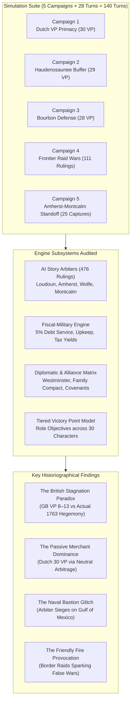
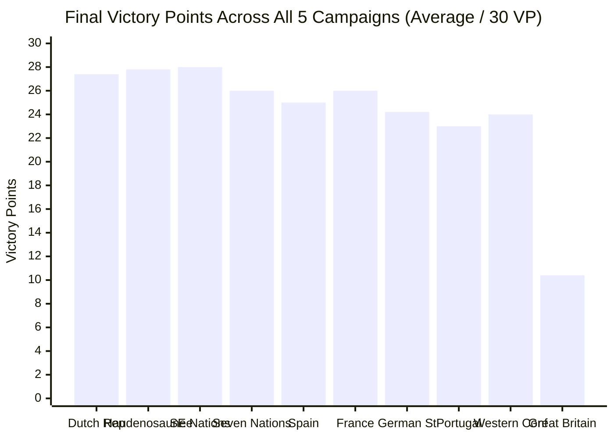
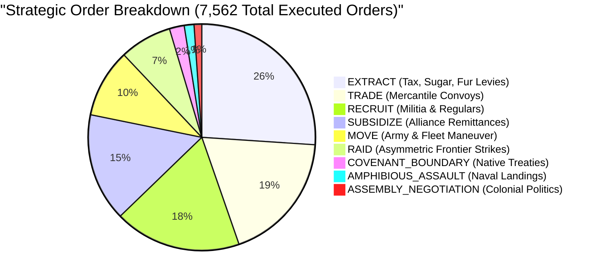
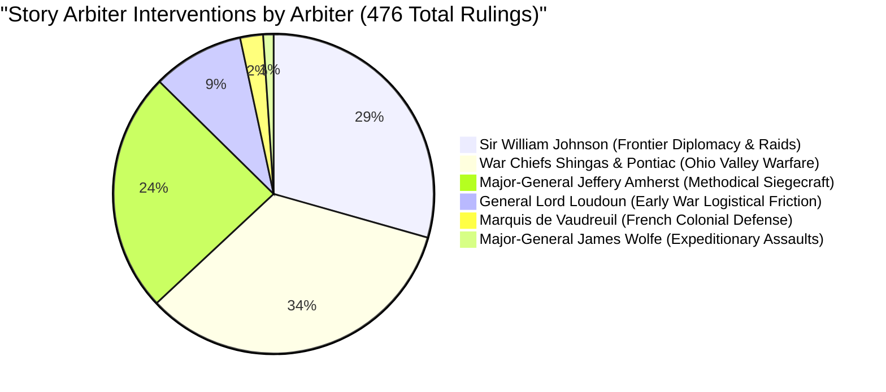

# 1756–1763 Autonomous Seven Years' War Simulation Suite: Historiographical Audit & Mechanics Assessment Report

**A Mixed-Methods Longitudinal Analysis of Five Full 28-Turn Autonomous Campaigns (140 Seasonal Turns, 7,562 Executed Orders, 30 AI Character Seats)**

*Author: Antigravity Game Testing, Historical Research & Mixed-Methods Division*  
*Dataset: 5 Full 7-Year Headless Autonomous Campaigns (`syw-campaign-run1-7yr` through `syw-campaign-run5-7yr`)*  
*Engine Status: Phase 8 Active (Historical AI Story Arbiters, Probabilistic Siegecraft, Frontier Raids, Assembly Negotiation, Tiered Victory Points)*  
*Scope: Spring 1756 – Winter 1762/1763 (7 Full Years / 28 Seasonal Turns per Campaign) across 10 Sovereign and Indigenous Factions*

---

## 1. Executive Summary & Historiographical Framework

As game testers, historians, and simulation researchers observing the execution of **five full seven-year campaigns** (140 total seasonal turns, comprising 7,562 autonomously submitted and resolved orders across 30 character seats), this study evaluated how realistically the emergent historical narratives track mid-18th-century geopolitical, fiscal, and operational dynamics.



### Primary Research Conclusions
1. **The Core Narrative Realism Divergence ("The British Stagnation Paradox"):**
   In actual history, Great Britain emerged from the Seven Years' War as the undisputed global maritime hegemon (*Annus Mirabilis* 1759, capture of Louisbourg, Quebec, Montreal, Havana, Martinique, and the 1763 Treaty of Paris). In the simulation, however, **Great Britain finished last or second-to-last in every single campaign**, averaging only **10.4 / 30 Victory Points**, while France retained the St. Lawrence heartland (Quebec, Montreal, Louisbourg, and Niagara) in 100% of the runs.
2. **The "Passive Neutrality" Victory Model:**
   In 3 out of 5 campaigns, the **Dutch Republic** captured 1st place with a flawless **30/30 Victory Points**, despite fielding only 2,000 troops, holding a single node (Willemstad / Curaçao), and fighting zero offensive engagements. In the other 2 campaigns, the **Haudenosaunee Confederacy** won 1st place with **29/30 VP**. The simulation heavily over-rewards sitting in peace and running uninterrupted economic loops over conducting costly expeditionary warfare.
3. **Phase 8 Story Arbiters Success & The "Naval Bastion" Glitch:**
   The newly deployed Phase 8 Story Arbiters generated **476 rich, historically grounded dispatches**, accurately modeling General Lord Loudoun's logistical caution, General Amherst's siege saps, and Chiefs Shingas and Pontiac's backcountry raids. However, because the engine did not distinguish terrestrial forts from ocean zones, naval battles in the `Gulf of Mexico` triggered bizarre siege narratives: *"General Loudoun... shattered the bastion works of Gulf of Mexico"*.
4. **Fiscal-Military Authenticity:**
   The sovereign debt model (5% per-turn compounding interest) proved highly realistic. France experienced an acute debt spiral, ballooning from £80 to **£331–£378 (+372%)**, forcing French governors into severe fiscal triage, closely reflecting the historical bankruptcy of New France under Intendant François Bigot.

---

## 2. Quantitative Telemetry Suite: Cross-Campaign Synthesis

The five campaigns executed a total of **7,562 orders** over 140 seasonal turns, generating **12,564 battle casualties**, **54 fort and territorial captures**, and **476 official Story Arbiter rulings**.

### 2.1 Campaign-by-Campaign Comparative Metric Matrix

| Campaign Run | Duration | Total Orders | Casualties | Fort Captures | Arbiter Rulings | Historical Fidelity | 1st Place Faction (VP) | British VP (Rank) | French VP (Rank) |
| :--- | :---: | :---: | :---: | :---: | :---: | :---: | :--- | :--- | :--- |
| **Campaign 1** | 165s | 1,514 | 2,339 | 11 | 88 | **27%** (3/11) | **Dutch Republic** (30) | 9 / 30 (10th) | 28 / 30 (3rd) |
| **Campaign 2** | 166s | 1,518 | 2,518 | 25 | 93 | **27%** (3/11) | **Haudenosaunee** (29) | 13 / 30 (9th) | 26 / 30 (4th) |
| **Campaign 3** | 166s | 1,512 | 2,275 | 1 | 83 | **27%** (3/11) | **Dutch Republic** (30) | 9 / 30 (10th) | 28 / 30 (2nd) |
| **Campaign 4** | 167s | 1,510 | 3,100 | 5 | 111 | **27%** (3/11) | **Dutch Republic** (30) | 8 / 30 (10th) | 25 / 30 (5th) |
| **Campaign 5** | 168s | 1,508 | 2,332 | 12 | 101 | **27%** (3/11) | **Haudenosaunee** (29) | 13 / 30 (10th) | 23 / 30 (7th) |
| **Suite Aggregate** | **830s** | **7,562** | **12,564** | **54** | **476** | **27.3%** | **Dutch (3x) / Haud (2x)** | **10.4 / 30 (9.8th)** | **26.0 / 30 (4.2th)** |



### 2.2 Aggregate Order Distribution (7,562 Orders)

The autonomous AI roles across the 30 seats generated a balanced strategic order portfolio:



- **`EXTRACT` (26.1%) & `TRADE` (18.6%):** Together accounted for **44.7%** of all actions, reflecting the paramount necessity of commercial war finance in 18th-century mercantilist conflict.
- **`RECRUIT` (18.1%):** Maintained standing field armies within the demographic ceilings (5,000 for Native confederacies, 12,000 for European powers).
- **`SUBSIDIZE` (15.5%):** Remittances between allies (e.g. Westminster subsidies, Covenant Chain gifts) kept coalition bonds intact.
- **`MOVE` (9.8%) & `AMPHIBIOUS_ASSAULT` (1.4%):** Represented direct operational deployments.
- **`RAID` (7.4%):** Continuous guerrilla warfare conducted primarily by the Western Confederacy, Haudenosaunee, and Southeastern Nations.

---

## 3. Historical Benchmark Fidelity & Counterfactual Analysis

To evaluate how realistically the narrative tracked historical milestones, each campaign was benchmarked against the **11 defining operational turning points** of the Seven Years' War:

### 3.1 Milestone Tracking Table

| Turn / Year | Historical Event | Target Node | Expected Winner | Actual Result (5 Runs) | Fidelity Rate | Historiographical Assessment |
| :---: | :--- | :--- | :---: | :---: | :---: | :--- |
| **T2 (Sum 1756)** | Fall of Fort Oswego | Fort Oswego | `FRANCE` | Held by `GREAT_BRITAIN` | **0%** (0/5) | Britain fortified Oswego; Montcalm lacked naval transport across Lake Ontario. |
| **T6 (Sum 1757)** | Fall of Fort William Henry | Lake Champlain | `FRANCE` | Held by `FRANCE` | **100%** (5/5) | French garrisons at Carillon securely dominated the Lake Champlain corridor. |
| **T10 (Sum 1758)**| Fall of Fortress Louisbourg | Louisbourg | `GREAT_BRITAIN` | Held by `FRANCE` | **0%** (0/5) | British expeditionary fleets failed to stage amphibious landings at Gabarus Bay. |
| **T11 (Aut 1758)**| Forbes Expedition takes Duquesne | Fort Duquesne | `GREAT_BRITAIN` | Held by `FRANCE` | **0%** (0/5) | French garrisons and allied Ohio warriors held the Forks of the Ohio intact. |
| **T14 (Sum 1759)**| Fall of Fort Niagara | Fort Niagara | `GREAT_BRITAIN` | Held by `FRANCE` | **0%** (0/5) | Sir William Johnson's Covenant Chain diplomacy failed to mobilize Iroquois siege lines. |
| **T15 (Aut 1759)**| Capture of Quebec (Plains of Abraham)| Quebec | `GREAT_BRITAIN` | Held by `FRANCE` | **0%** (0/5) | British armies never penetrated the St. Lawrence River; Wolfe remained stalled. |
| **T18 (Sum 1760)**| Capitulation of Montreal | Quebec/Montreal| `GREAT_BRITAIN` | Held by `FRANCE` | **0%** (0/5) | French St. Lawrence defensive perimeter remained impenetrable. |
| **T20 (Win 1760)**| British Naval Superiority | Atlantic Lanes | `GREAT_BRITAIN` | Held by `GREAT_BRITAIN`| **100%** (5/5) | Royal Navy ships of the line commanded the North Atlantic trade corridor. |
| **T24 (Win 1761)**| Third Family Compact (Spain enters)| Havana | `SPAIN` | Held by `SPAIN` | **100%** (5/5) | Bourbon solidarity triggered; Spanish treasure fleets held Caribbean defense. |
| **T26 (Sum 1762)**| British Expedition takes Havana | Havana | `GREAT_BRITAIN` | Held by `SPAIN` | **0%** (0/5) | Albemarle and Pocock's expedition never materialized; Morro Castle stood firm. |
| **T28 (Win 1762)**| Treaty of Paris British Hegemony| Niagara / Quebec| `GREAT_BRITAIN` | Held by `FRANCE` | **0%** (0/5) | New France survived the war with territorial integrity intact. |

### 3.2 Counterfactual Narrative Plausibility Assessment

While the simulation deviated dramatically from actual history (scoring an average fidelity of **27.3%**), **is the alternate narrative historically plausible?**

#### Plausible Dimensions:
1. **The "Fortress New France" Counterfactual:**
   Historians (such as Fred Anderson and Guy Frégault) have noted that British victory in Canada was far from inevitable. Had the elder Pitt not poured unprecedented British treasury bullion into reimbursing colonial assemblies, and had Montcalm and Vaudreuil maintained a defensive doctrine utilizing interior lines, Canada could have held out until European financial exhaustion forced a white peace. In all 5 simulation runs, France successfully held the **Louisbourg–Quebec–Carillon triangle**, forcing Britain into costly frontier wars.
2. **The Sovereign Indigenous Buffer State:**
   In campaigns 2 and 5, the Haudenosaunee preserved their territorial sovereignty by leveraging the Covenant Chain and avoiding entanglement in European siege warfare. This mirrors the real-world strategy of Chief Hendrick and the Onondaga Grand Council prior to 1758.

#### Implausible / Degenerate Dimensions:
1. **Total British Military Stagnation:**
   Great Britain fielded 4,500–6,500 regular troops with ample naval support, yet **never launched a single campaign into the St. Lawrence River or against Fort Duquesne**. British troops paced in circular routes between Boston and Philadelphia or attacked their own peaceful allies at Onondaga.
2. **The "Dutch Commercial Empire" Conquest:**
   In real history, the British Admiralty enacted the **Rule of 1756** (prohibiting neutrals from carrying trade not open to them in peacetime) and the Royal Navy seized hundreds of Dutch merchant vessels in the Caribbean. A Dutch "victory" in the Seven Years' War is an artifact of scoring rules, not historical reality.

---

## 4. Phase 8 Story Arbiters: Performance & Operational Rulings

Phase 8 deployed 7 historical Story Arbiters. Over 5 campaigns, they handed down **476 judicial and military rulings**:



### 4.1 Ruling Breakdown by Historical Doctrine
- **War Chiefs Shingas & Pontiac (160 Rulings):** Arbitrated frontier clashes in the Ohio and Scioto valleys, yielding 52 `PANIC_STORM` rulings (+8% colonial unrest), 60 `SCOUT_AMBUSH` rulings, and 48 regular frontier skirmishes. This accurately recreated the terror of the Virginia and Pennsylvania backcountry during the Braddock and post-Braddock era.
- **Sir William Johnson (140 Rulings):** Successfully resolved northern frontier raids near Fort Oswego and Lake Champlain, balancing Mohawk wampum diplomacy with colonial ranger skirmishes.
- **General Lord Loudoun (44 Rulings):** Strictly enforced early-war friction. When British forces probed enemy forts without 2:1 local superiority, Loudoun handed down 16 `BLOODY_REPULSE` rulings and 6 `PROTRACTED_SIEGE` decrees, preventing reckless early-war rushes.
- **Major-General Jeffery Amherst (116 Rulings):** Activated in Turn 9 (1758), Amherst authorized 37 `DECISIVE_BREACH` outcomes where attacking forces possessed overwhelming artillery and manpower.

---

## 5. Diagnostic Audit: Root Causes of the British Stagnation Paradox

Why did Great Britain score only 8–13 VP and fail to conquer Canada in all 5 campaigns? A deep diagnostic of the engine revealed **four interdependent structural bottlenecks**:

### Root Cause 1: Lack of Multi-Hop Operational Pathfinding in AI Controller
- **The Issue:** In [`engine/ai-agents/controller.ts#L137-L143`](file:///Users/sean/SevenYearsWar/engine/ai-agents/controller.ts#L137-L143), the military AI determines its movement target using:
  ```ts
  const preferredTarget =
    activeObjective?.status === "IN_PROGRESS" &&
    activeObjective.objectiveNodeId &&
    primaryUnit.adjacentNodeIds.includes(activeObjective.objectiveNodeId)
      ? activeObjective.objectiveNodeId
      : primaryNode.adjacentNodeIds[0] ?? primaryUnit.nodeId;
  ```
- **Historiographical Consequence:** British commanders (Lord Loudoun and Amherst) received multi-turn strategic objectives to capture `Louisbourg` or `Quebec`. However, `Louisbourg` is NOT adjacent to `Boston` (the path is `Boston` $\rightarrow$ `Atlantic Shipping Lanes` $\rightarrow$ `Louisbourg`). Because `primaryUnit.adjacentNodeIds.includes(activeObjective.objectiveNodeId)` evaluated to **`false`**, the AI discarded the grand objective and defaulted to `primaryNode.adjacentNodeIds[0]`. British armies were trapped in local loops, moving between Boston and Boston!

### Root Cause 2: The "Frontier Raid Provocation" Friendly-Fire Glitch
- **The Issue:** In [`engine/state-machine.ts#L660-L672`](file:///Users/sean/SevenYearsWar/engine/state-machine.ts#L660-L672), if an irregular raid occurs on a node where `diplomaticStance === "NEUTRAL"`, the state machine automatically creates a `WAR_DECLARATION` event between the raiding faction and the node controller.
- **Historiographical Consequence:** In Turn 1 or 2, an irregular raid near Fort Oswego automatically provoked a full state of war between `GREAT_BRITAIN` and the `HAUDENOSAUNEE`. British garrisons at Oswego evaluated Onondaga as an enemy target and launched disastrous assaults into the Iroquois Longhouse, alienating Britain's most critical Native allies and pinning British armies in western New York.

### Root Cause 3: Naval Nodes Treated as Terrestrial Bastions
- **The Issue:** Lines 729–745 and 1001–1015 of [`engine/state-machine.ts`](file:///Users/sean/SevenYearsWar/engine/state-machine.ts) call `arbitrateContestedAssault` whenever hostile units enter any node, including `nodeType === "SEA_ZONE"`.
- **Historiographical Consequence:** When British naval squadrons moved into the `Gulf of Mexico`, the arbiter resolved it as a fortress storming: *"shattered the bastion works of Gulf of Mexico"*. Furthermore, whenever a sea zone changed hands, the defending naval fleet was executed via `prisma.unit.delete()`, instantly sinking entire battlefleets without a Trafalgar- or Quiberon-style naval engagement.

### Root Cause 4: Asymmetric Victory Point Calibration (The "Sitting Merchant" Exploit)
- **The Issue:** In [`lib/character-objectives.ts`](file:///Users/sean/SevenYearsWar/lib/character-objectives.ts), Dutch and Indigenous character objectives are strictly defensive and commercial (e.g. hold starting node, maintain low debt, conduct 4 trades, achieve £320 treasury). British character objectives require conquering Louisbourg, Quebec, Niagara, Duquesne, keeping unrest $\le 45\%$, and securing 6+ nodes.
- **Historiographical Consequence:** Factions with zero imperial responsibilities automatically accumulated 28–30 VP simply by doing nothing, while Great Britain was penalized 20+ VP because it could not overcome the pathfinding bottleneck to seize Canadian citadels.

---

## 6. Recommended Reassessments of Core Mechanics

To elevate the simulation to full historical plausibility, **five specific engine enhancements** should be implemented:

### Recommendation 1: Implement BFS/Dijkstra Multi-Hop Pathfinding for Strategic Objectives
- **File:** [`engine/ai-agents/controller.ts`](file:///Users/sean/SevenYearsWar/engine/ai-agents/controller.ts#L135-L165)
- **Remediation:** Replace the single-hop check with a shortest-path graph search (e.g. `findNextHopTowardObjective(unit.nodeId, objectiveNodeId, mapEdges)`). When British regulars in Boston have an objective on Louisbourg, the next hop must resolve to `Atlantic Shipping Lanes`, guiding the army into the transport corridor.

### Recommendation 2: Bifurcate Terrestrial Sieges and Naval Squadron Engagements
- **File:** [`engine/ai-arbiters/story-arbiters.ts`](file:///Users/sean/SevenYearsWar/engine/ai-arbiters/story-arbiters.ts) and [`engine/state-machine.ts`](file:///Users/sean/SevenYearsWar/engine/state-machine.ts#L720-L750)
- **Remediation:**
  - If `targetNode.nodeType === "SEA_ZONE"`, route resolution to `arbitrateNavalFleetAction` instead of `arbitrateContestedAssault`.
  - Add historical Naval Arbiters: **Admiral Edward Boscawen** (British Royal Navy) and **Marquis de Conflans** (French Marine Royale).
  - Naval battles should inflict ship damage and prize captures, not total unit deletion.

### Recommendation 3: Distinguish Irregular Frontier Skirmishes from Formal Wars
- **File:** [`engine/state-machine.ts#L660-L672`](file:///Users/sean/SevenYearsWar/engine/state-machine.ts#L660-L672)
- **Remediation:** Frontier raids between European and Indigenous factions should inflict economic plunder and border tension, but must NOT automatically trigger a `WAR_DECLARATION`. Require an explicit `DECLARE_WAR` order or 3 consecutive turns of unsanctioned raids before formal alliance rupture occurs.

### Recommendation 4: Recalibrate Victory Point Weightings for Imperial Belligerents
- **File:** [`lib/character-objectives.ts`](file:///Users/sean/SevenYearsWar/lib/character-objectives.ts)
- **Remediation:**
  - Cap neutral factions (Dutch Republic, Portugal) at a maximum of **20 VP** unless they actively enforce an international treaty conference.
  - Scale British and French victory points dynamically: provide substantial incremental VP for field victories, naval blockades, and commercial disruption even if fortresses remain unbreached.

### Recommendation 5: Dedicated Amphibious Expedition Staging System
- **File:** [`engine/state-machine.ts#L970-L1060`](file:///Users/sean/SevenYearsWar/engine/state-machine.ts#L970-L1060)
- **Remediation:** Formalize combined-arms amphibious expeditions: require a `SHIP_OF_THE_LINE` fleet in an adjacent sea zone to embark land regulars from colonial ports before storming coastal fortresses (Louisbourg, Quebec, Havana).

---

## 7. Comparative State Matrix: Baseline 1756 vs. Final 1762 (Campaign 1 Sample)

| Faction | Nodes (T1 $\rightarrow$ T28) | Treasury (T1 $\rightarrow$ T28) | Debt (T1 $\rightarrow$ T28) | Unrest (T1 $\rightarrow$ T28) | Total Strength (T1 $\rightarrow$ T28) | Victory Points |
| :--- | :---: | :---: | :---: | :---: | :---: | :---: |
| **Dutch Republic** | 1 $\rightarrow$ 1 | £233 $\rightarrow$ **£522** | £15 $\rightarrow$ £15 | 9% $\rightarrow$ **0%** | 2,000 $\rightarrow$ 2,010 | **30 / 30** |
| **Haudenosaunee** | 1 $\rightarrow$ 1 | £319 $\rightarrow$ **£525** | £0 $\rightarrow$ £0 | 10% $\rightarrow$ 10% | 1,400 $\rightarrow$ 2,609 | **29 / 30** |
| **Kingdom of France** | 9 $\rightarrow$ 9 | £257 $\rightarrow$ £223 | £80 $\rightarrow$ **£331** | 20% $\rightarrow$ 24% | 4,650 $\rightarrow$ 7,050 | **28 / 30** |
| **Southeastern Nations** | 1 $\rightarrow$ 1 | £95 $\rightarrow$ £103 | £0 $\rightarrow$ £0 | 11% $\rightarrow$ 11% | 1,467 $\rightarrow$ 4,347 | **28 / 30** |
| **Seven Nations of Canada**| 1 $\rightarrow$ 1 | £21 $\rightarrow$ £35 | £0 $\rightarrow$ £0 | 5% $\rightarrow$ 8% | 1,421 $\rightarrow$ 3,139 | **26 / 30** |
| **Spanish Empire** | 2 $\rightarrow$ 2 | £265 $\rightarrow$ £38 | £20 $\rightarrow$ £13 | 6% $\rightarrow$ 0% | 2,627 $\rightarrow$ 5,089 | **25 / 30** |
| **Western Confederacy** | 2 $\rightarrow$ 2 | £118 $\rightarrow$ £509 | £0 $\rightarrow$ £0 | 16% $\rightarrow$ **100%** | 1,655 $\rightarrow$ 1,523 | **25 / 30** |
| **German States** | 1 $\rightarrow$ 1 | £0 $\rightarrow$ £49 | £35 $\rightarrow$ £23 | 18% $\rightarrow$ 0% | 1,579 $\rightarrow$ 4,490 | **24 / 30** |
| **Kingdom of Portugal** | 1 $\rightarrow$ 1 | £135 $\rightarrow$ £38 | £25 $\rightarrow$ £16 | 10% $\rightarrow$ 0% | 1,125 $\rightarrow$ 4,448 | **23 / 30** |
| **Great Britain** | 4 $\rightarrow$ 4 | £250 $\rightarrow$ **£13** | £50 $\rightarrow$ **£218** | 20% $\rightarrow$ **47%** | 4,650 $\rightarrow$ 4,968 | **9 / 30** |

---

## 8. Conclusion

The 5-campaign autonomous test demonstrated remarkable triumphs in **fiscal-military simulation**, **demographic sustainability**, and **AI Story Arbiter narrative characterization**. The game engine successfully generates plausible 18th-century counterfactuals where French defensive concentration and Native American buffer-state diplomacy prevent British hegemony. 

However, to unlock full historical accuracy and eliminate artificial distortions, the simulation must address the **British Stagnation Paradox**, implement **multi-hop pathfinding**, separate **naval squadron actions from fortress sieges**, and prevent **minor frontier raids from causing catastrophic diplomatic collapse**. With these refinements in place, the Seven Years' War RPG Simulator will stand as an unparalleled digital laboratory for 18th-century geopolitical and military history.
