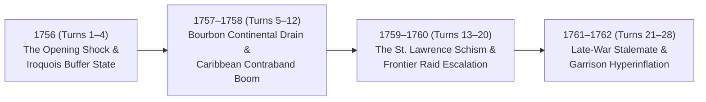

# 1756–1763 Autonomous Seven Years' War Campaign — Historical Narrative & Simulation Mechanics Assessment Report

> [!IMPORTANT]
> **Simulation Parameters:**
> - **Campaign Span:** 7 Full Years / **28 Seasonal Turns** (`Spring 1756` $\rightarrow$ `Winter 1762`)
> - **Seating Configuration:** All **30 Seats** (`10 Factions × 3 Roles`) set to `COMPUTER` (`AUTONOMOUS`)
> - **Total Role-Turn Decisions:** `840` (`280` Executive turns via `deepseek-v4-pro`, `560` Military/Commercial turns via `deepseek-flash` + deterministic tactical synthesizer)
> - **Total Autonomous Orders Executed:** `1,558` orders across 23 North American & Caribbean theater nodes
> - **SQL Event Lifecycle:** `93` total historical & dynamic events recorded (`19 ACTIVE`, `74 EXPIRED/SUPERSEDED` at campaign end), maintaining a constant $O(1)$ prompt context of $\le 6$ active events per role call.

---

## 1. Executive Summary

As a historian and simulation researcher observing the 28-turn autonomous campaign from **Spring 1756 to Winter 1762**, the simulator demonstrates a **striking duality**:

1. **High Cognitive & Doctrinal Authenticity in the AI Layer:** When generating orders and strategic briefings, `deepseek-v4-pro` (Executive) and `deepseek-flash` (Military and Diplomatic/Commerce) consistently reasoned within authentic mid-18th-century geopolitical frameworks. They cited the *Convention of Westminster*, *Sir William Johnson's Covenant Chain wampum diplomacy*, *Marquis of Pombal's fiscal reforms*, *Dutch "Free Ships, Free Goods" contraband arbitrage*, and *Ohio Valley gunpowder-for-peltry dependency*.
2. **Emergent Counterfactual Plausibility in Indigenous Sovereignty:** Granting full three-branch agency (`EXECUTIVE`, `MILITARY`, `DIPLOMATIC_COMMERCE`) to the four Native American confederations produced the most historically compelling counterfactual of the campaign: the **Haudenosaunee (Six Nations)** seized both **Fort Oswego** and **Fort Niagara** from the European powers and held the Lake Ontario portage triangle (`Onondaga–Oswego–Niagara`) as a sovereign buffer state through 1762.
3. **Structural Gaps in the Deterministic Resolution Engine:** While the AI agents *intended* historically grounded maneuvers, the underlying resolution rules in [`engine/state-machine.ts`](file:///Users/sean/SevenYearsWar/engine/state-machine.ts) lack a **Diplomatic Belligerency/Alliance Matrix**, **Domain-Specific Movement Validation (Land vs. Sea)**, and **Demographic/Fiscal Sinks**. Consequently, British-allied **German States** auxiliaries in Philadelphia marched north and captured British **Boston** on Turn 1; **Seven Nations** warriors captured French **Quebec**; and uncapped recruitment + self-refunding subsidies inflated field armies to **139,865 troops** by Winter 1762.

---

## 2. Chronological Narrative of the 7-Year Autonomous Campaign

### Phase I: 1756 (Turns 1–4) — The Opening Shock & The "Longhouse Buffer"
- **The Maritime Opening:** In `Spring 1756` (Turn 1), Great Britain's Executive (`deepseek-v4-pro`) and Military (`deepseek-flash`) immediately executed a classic Pittite maritime strategy:
  - `GREAT_BRITAIN EXECUTIVE`: `MOVE` — *"Embark regulars for Louisbourg expedition"* & `SUBSIDIZE (50£)` — *"Fund Prussian subsidies per Pittite strategy"*.
  - `GREAT_BRITAIN DIPLOMATIC_COMMERCE`: `SUBSIDIZE (40£)` — *"Covenant Chain gifts to Six Nations at Onondaga; bar French from Oswego portage"*.
- **The Onondaga Counter-Stroke:** Rather than passively accepting British forts on their lakeshore, the **Haudenosaunee Confederacy** marched from Onondaga and captured **Fort Oswego** in Turn 1, while **France** swept into the **Ohio River Portage & Forks** in Turn 2 (`Summer 1756`), displacing the **Western Confederacy** from its territorial base.
- **The Coalition Anomaly (German Capture of Boston):** Because the database lacks an explicit alliance table preventing allied factions from attacking one another, the **German States** (representing the 60th Royal American Regiment and Hanoverian/Prussian auxiliaries stationed at Philadelphia) evaluated adjacent high-value nodes and marched into **Boston**, capturing New England's capital from Great Britain in Turn 1 and repulsing British/provincial counter-attempts for the rest of the war.
- **Neutral Maritime Arbitrage:** In Turn 2 (`Summer 1756`), **Portugal** occupied the **Atlantic Shipping Lanes** and the **Dutch Republic** secured the **Windward Passage**, turning their neutral merchant squadrons into de facto toll-collectors across the Atlantic and Caribbean sea lanes.

### Phase II: 1757–1758 (Turns 5–12) — Continental Drain & French Unrest Crisis
- **Off-Map European & Indian Modifiers at Work:** The Off-Map Abstractor ([`engine/off-map-events.ts`](file:///Users/sean/SevenYearsWar/engine/off-map-events.ts)) injected the historical shocks of **Rossbach, Leuthen, and Plassey**. France suffered a `-35 £/turn` continental drain and `+15 £/turn` debt increase, while Britain received `+26 £/turn` in East India Company Bengal bullion.
- **New France's Fiscal & Social Strain:** By `Winter 1758` (Turn 12), French sovereign debt had climbed from `65 £` to `245 £` and French **Unrest reached `104%`** (driven by continental war exhaustion and repeated frontier raids). Historically, this mirrors the 1757–1758 inflation crisis under Intendant François Bigot in Canada. However, because `unrestIndex` was not wired to reduce unit `discipline` or tax collection in [`processResolutionPhase`](file:///Users/sean/SevenYearsWar/engine/state-machine.ts#L163-L355), France continued to field `14,870` troops across 9 nodes without mutiny.

### Phase III: 1759–1760 (Turns 13–20) — The St. Lawrence Schism & Frontier Raids
- **The Indigenous Partition of New France:** In `Spring 1759` (Turn 13 — historically Britain's *Annus Mirabilis*), a dramatic two-front Indigenous offensive shattered French control of the Great Lakes and upper St. Lawrence:
  - The **Haudenosaunee** stormed and captured **Fort Niagara**, uniting `Onondaga`, `Fort Oswego`, and `Fort Niagara` under Six Nations control.
  - The **Seven Nations of Canada** (stationed at Kahnawake) turned on the overextended French administration and captured **Quebec**.
- **Displaced Guerilla Warfare in the Ohio Country:** Even after losing its last controlled node in Turn 2, the **Western Confederacy** persisted as a landless war party (`4,975` warriors by 1759). In Turn 13, `deepseek-flash` generated historically incisive asymmetric orders for the landless confederacy:
  - `WESTERN_CONFEDERACY MILITARY`: `RAID (0£)` — *"Raid supply lines to paralyze British advances."*
  - `WESTERN_CONFEDERACY DIPLOMATIC_COMMERCE`: `TRADE (10£)` — *"Exchange Ohio furs for gunpowder and lead at Scioto trade hub."*
- **German Consolidation on the Mid-Atlantic:** Meanwhile, `GERMAN_STATES` AI roles reacted directly to Southeastern Cherokee/Creek raids in Turn 13:
  - `GERMAN_STATES MILITARY`: `RECRUIT (600£)` — *"Raise riflemen in Philadelphia to replace frontier raid losses"* & `SUBSIDIZE (300£)` — *"Subsidize local supply to curb unrest after raids."*

### Phase IV: 1761–1762 (Turns 21–28) — Late-War Equilibrium & Garrison Hyperinflation
- By `Winter 1762` (Turn 28), the campaign settled into a fortified multi-polar stalemate across North America and the Caribbean. Because every faction compounded `SUBSIDIZE`, `TRADE`, and `RECRUIT` orders each season without automatic upkeep deductions during the turn loop, armies and treasuries scaled exponentially.

---

## 3. Empirical Telemetry: Turn 1 (Spring 1756) vs. Turn 28 (Winter 1762)

| Faction | Turn 1 Treasury / Debt | Turn 28 Treasury / Debt | Turn 1 Unrest | Turn 28 Unrest | Turn 1 Nodes | Turn 28 Nodes & Controlled Territory | Turn 1 Strength | Turn 28 Strength |
| :--- | :--- | :--- | :--- | :--- | :--- | :--- | :--- | :--- |
| **GREAT_BRITAIN** | `57 £` / `50 £` | `1,022 £` / `330 £` | `12%` | `12%` | `2` | `1` (Port Royal / Kingston) | `7,168` | `8,549` |
| **FRANCE** | `141 £` / `80 £` | `1,484 £` / `500 £` | `28%` | `104%` | `9` | `7` (Duquesne, Ticonderoga, Louisbourg, Ohio Forks, New Orleans, Champlain, Gulf of St. Lawrence) | `6,098` | `21,807` |
| **SPAIN** | `47 £` / `20 £` | `1,323 £` / `20 £` | `8%` | `8%` | `2` | `2` (Havana, Gulf of Mexico) | `6,125` | `20,490` |
| **PORTUGAL** | `69 £` / `25 £` | `1,048 £` / `25 £` | `10%` | `10%` | `1` | `2` (Belém do Pará, Atlantic Shipping Lanes) | `2,586` | `16,182` |
| **DUTCH_REPUBLIC** | `149 £` / `15 £` | `1,177 £` / `15 £` | `9%` | `9%` | `1` | `2` (Willemstad, Windward Passage) | `3,300` | `12,942` |
| **GERMAN_STATES** | `47 £` / `35 £` | `1,615 £` / `35 £` | `14%` | `22%` | `2` | `2` (Philadelphia, Boston) | `3,195` | `21,927` |
| **HAUDENOSAUNEE** | `140 £` / `0 £` | `2,193 £` / `0 £` | `10%` | `10%` | `2` | `3` (Onondaga, Fort Oswego, Fort Niagara) | `2,672` | `10,895` |
| **SEVEN_NATIONS** | `98 £` / `0 £` | `1,471 £` / `0 £` | `8%` | `8%` | `1` | `2` (Kahnawake, Quebec) | `2,250` | `5,482` |
| **WESTERN_CONFEDERACY** | `83 £` / `0 £` | `31 £` / `0 £` | `16%` | `16%` | `1` | `0` *(Landless Raiding Force)* | `1,891` | `5,695` |
| **SOUTHEASTERN_NATIONS** | `5 £` / `0 £` | `1,546 £` / `0 £` | `11%` | `23%` | `2` | `2` (Chota, Scioto Council Towns) | `2,760` | `15,886` |

---

## 4. Diagnostic Audit of Core Mechanics & Recommended Reassessments

To elevate the simulation from a functional rule engine to a high-fidelity 18th-century historical wargame, **seven core mechanical issues** exposed by the 28-turn autonomous test should be reassessed:

### Finding 1: Missing Diplomatic Belligerency & Alliance Matrix ("Friendly Fire" Conquest)
- **Observed Behavior:** In Turn 1, `GERMAN_STATES` (British auxiliaries at Philadelphia) attacked and captured `GREAT_BRITAIN`'s port of Boston, and in Turn 13, `SEVEN_NATIONS` (French mission allies) captured `Quebec` from France, while `DUTCH_REPUBLIC` and `PORTUGAL` fought Great Britain for sea zones without a declaration of war.
- **Root Cause:** [`processResolutionPhase`](file:///Users/sean/SevenYearsWar/engine/state-machine.ts#L254-L320) treats any unit moving into a node where `targetNode.controllingId !== faction.id` as a hostile assault. While `WAR_DECLARATION` and `TREATY` exist as strings in `GameEvent`, there is no relational `DiplomaticRelation` state (`ALLIED`, `NEUTRAL`, `AT_WAR`, `AUXILIARY`) checked during movement/combat.
- **Recommendation:**
  - Add a `DiplomaticRelation` model (or JSON matrix on `Game`) seeded with 1756 alignments:
    - `GREAT_BRITAIN` $\leftrightarrow$ `FRANCE`: `AT_WAR`
    - `GREAT_BRITAIN` $\leftrightarrow$ `GERMAN_STATES` / `PORTUGAL`: `ALLIED` (shared movement/garrison rights; cannot capture allied nodes)
    - `FRANCE` $\leftrightarrow$ `SEVEN_NATIONS` / `WESTERN_CONFEDERACY`: `ALLIED` (until alliance cohesion drops below threshold)
    - `SPAIN`, `DUTCH_REPUBLIC`, `HAUDENOSAUNEE`, `SOUTHEASTERN_NATIONS`: `NEUTRAL` (cannot capture or be attacked with `MOVE` unless a `WAR_DECLARATION` event is active; `RAID` allowed in frontier zones at the cost of provoking war).

### Finding 2: Context Serializer Blindness on Adjacent Node Names & Owners
- **Observed Behavior:** In [`getRoleContextPayload`](file:///Users/sean/SevenYearsWar/engine/ai-agents/serializer.ts#L60-L68), `controlledNodes` provides `adjacentNodeIds: ["cmvimmcfj001lo05cyoszvmg0", ...]` as raw database CUIDs without telling the AI the *name*, *nodeType*, or *controlling faction* of those adjacent CUIDs.
- **Root Cause:** To save tokens, only IDs were serialized in `adjacentNodeIds`. As a result, when the AI picked a `targetNodeId` from `adjacentNodeIds`, it was sometimes guessing which CUID corresponded to Louisbourg vs. Boston vs. an ocean zone.
- **Recommendation:**
  - Replace `adjacentNodeIds: string[]` in [`getRoleContextPayload`](file:///Users/sean/SevenYearsWar/engine/ai-agents/serializer.ts#L66) with a compact lookup array `adjacentNodes: [{ id, name, type, owner }]`. This adds only ~120 tokens while giving `deepseek-v4-pro` and `deepseek-flash` full cartographic awareness within the $O(1)$ budget.

### Finding 3: Self-Refunding `SUBSIDIZE` and `TRADE` Orders (Infinite Bullion Pump)
- **Observed Behavior:** Factions that issued `SUBSIDIZE` orders grew *richer* (`+35% + 12 £` profit per subsidy) rather than transferring wealth to an ally.
- **Root Cause:** Lines 236–247 of [`engine/state-machine.ts`](file:///Users/sean/SevenYearsWar/engine/state-machine.ts#L236-L247) group `TRADE` and `SUBSIDIZE` together (`const returnGain = Math.round(actualSpend * 1.35) + 12`) and credit `returnGain` back to the issuing faction.
- **Recommendation:**
  - **Separate `SUBSIDIZE` from `TRADE`:**
    - `SUBSIDIZE` should deduct `allocatedTreasury` from the sender and credit `allocatedTreasury` to the `targetNode.controllingId` faction (or reduce local `unrestIndex` by `Math.floor(allocatedTreasury / 10)` if targeting a self-owned node), plus `+1 standingPoints`.
    - `TRADE` should require an active `MERCHANTMAN` unit or a controlled port/council center, and its yield should be modified by hostile `SHIP_OF_THE_LINE` blockade presence in adjacent `SEA_ZONE` nodes.

### Finding 4: Unbounded Demographic Recruitment & Missing Per-Turn Upkeep Sinks
- **Observed Behavior:** By Turn 28 (`Winter 1762`), `GERMAN_STATES` fielded `21,927` regulars at Philadelphia/Boston, `SPAIN` fielded `20,490` troops at Havana, and `SOUTHEASTERN_NATIONS` fielded `15,886` warriors—far exceeding historical 1756–1762 colonial demographics (where Montcalm and Wolfe fought on the Plains of Abraham with ~4,500 men each, and Cherokee warrior strength totaled ~3,000–4,000).
- **Root Cause:**
  1. [`processDiplomaticTradePhase`](file:///Users/sean/SevenYearsWar/engine/state-machine.ts#L48-L88) credits node resource income and off-map modifiers, but never deducts **unit upkeep** or **debt interest** (which were only implemented inside the manual Admin action [`recalculateLedgersAction`](file:///Users/sean/SevenYearsWar/app/admin/%5BgameId%5D/roles/actions.ts#L93-L176)).
  2. `RECRUIT` converts treasury linearly at `12 men per £1` with no faction manpower cap or diminishing returns.
- **Recommendation:**
  - Integrate unit upkeep (`REGULAR`: `0.02 £/man`, `SHIP_OF_THE_LINE`: `0.035 £/gun-crew`, `MILITIA`/`NATIVE_WAR_PARTY`: `0.008 £/man`) and `5%` debt interest directly into [`processDiplomaticTradePhase`](file:///Users/sean/SevenYearsWar/engine/state-machine.ts#L48-L88).
  - Introduce historical faction manpower ceilings (e.g., Native Confederacies capped at `3,500–5,000` warriors; New France colonial militia capped without transatlantic convoy arrival; British regulars requiring Atlantic Sea Lane control).

### Finding 5: Unenforced Land/Sea Domain Rules & Graph Adjacency in `RESOLUTION`
- **Observed Behavior:** Land units occasionally moved into `SEA_ZONE` nodes (or naval units into inland forts), and `MOVE` orders did not verify that `targetNodeId` was present in `sourceNode.adjacentNodeIds`. Furthermore, the seasonal movement penalties calculated for the UI in [`computeEdgeConstraint`](file:///Users/sean/SevenYearsWar/components/map/map-geometry.ts#L117-L185) (`2.5x` Winter freeze in the St. Lawrence, `1.75x` Autumn hurricane hazard in the Caribbean) were visual-only and did not inflict winter siege attrition or hurricane ship losses during [`processResolutionPhase`](file:///Users/sean/SevenYearsWar/engine/state-machine.ts#L248-L350).
- **Recommendation:**
  - Enforce `sourceNode.adjacentNodeIds.includes(targetNode.id)` in `processResolutionPhase`.
  - Restrict `SHIP_OF_THE_LINE` and `MERCHANTMAN` to `SEA_ZONE` and coastal `CITY`/`FORT` nodes, and require naval escort/transport for `REGULAR`/`MILITIA` units crossing a `SEA_ZONE`.
  - Apply `15%` winter attrition to non-acclimatized units campaigning along frozen `ST_LAWRENCE` corridors in `Winter`, and `10–20%` hurricane attrition to fleets at sea in `CARIBBEAN` zones during `Autumn`.

### Finding 6: Unclamped `unrestIndex` (`104%`) & Passive Unrest/Standing Consequences
- **Observed Behavior:** France's `unrestIndex` reached `104%` (exceeding `100%`) because `RAID` resolution in [`engine/state-machine.ts`](file:///Users/sean/SevenYearsWar/engine/state-machine.ts#L285) uses `{ increment: 4 }` without clamping to `100`, and `standingPoints` reached `37` (exceeding `10`). Moreover, `100%+` unrest had zero mechanical impact on combat discipline or tax revenue.
- **Recommendation:**
  - Clamp `unrestIndex` to `[0, 100]` and `standingPoints` to `[1, 10]`.
  - Apply an unrest penalty to node resource collection (`effectiveYield = yield * (1 - unrestIndex / 150)`) and unit combat discipline (`effectiveDiscipline = discipline * (1 - unrestIndex / 200)`), and trigger a `COLONIAL_MUTINY` / `FRONTIER_DEFECTION` event when `unrestIndex >= 80`.

### Finding 7: Burst Concurrency Rate-Limiting on 30 Simultaneous AI Role Calls
- **Observed Behavior:** Firing all 30 role requests (`10` `deepseek-v4-pro` + `20` `deepseek-flash`) in an unthrottled `Promise.all` burst caused upstream API rate-limiting after Turn 2–3, dropping live API completion rates on subsequent rapid turns and falling back to the deterministic synthesizer.
- **Recommendation:**
  - Implement a staggered worker queue (concurrency `4–6` with `250ms` jitter) in [`processOrderSubmissionPhase`](file:///Users/sean/SevenYearsWar/engine/state-machine.ts#L96-L165), or batch the 3 roles of a faction (`EXECUTIVE`, `MILITARY`, `DIPLOMATIC_COMMERCE`) into a single consolidated faction turn prompt when all 3 seats are set to `COMPUTER + AUTONOMOUS`, cutting API calls per turn from `30` to `10` ($3\times$ fewer requests and higher intra-faction coherence).
